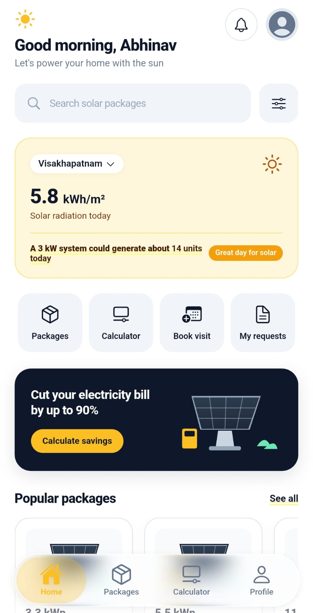
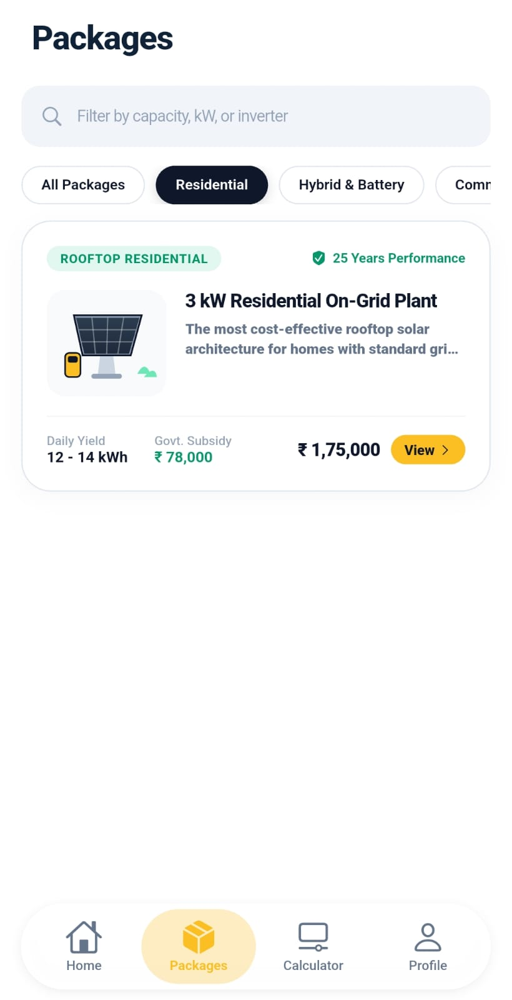
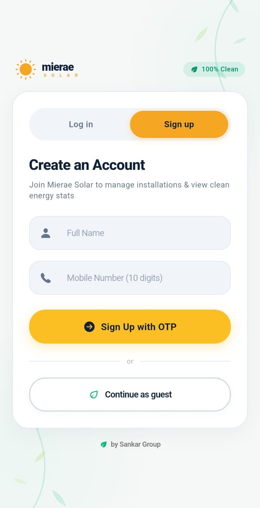
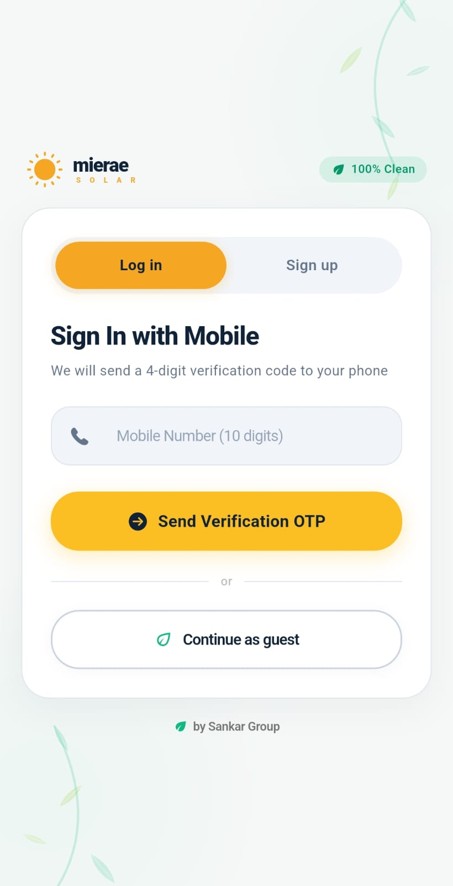
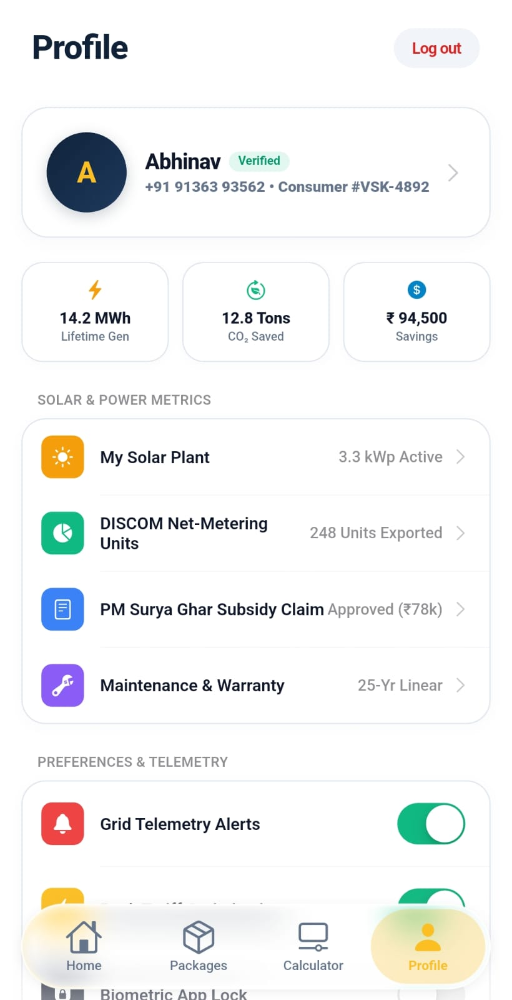
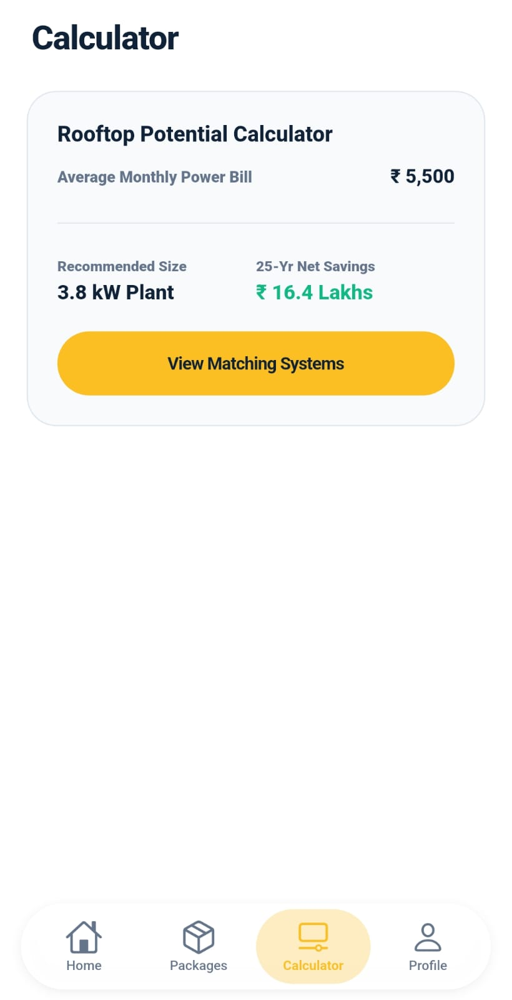

# Mierae Solar — Sankar Group Mobile App

> **Flutter Development Internship Assignment**  
> **Role:** Flutter Developer Intern  
> **Company:** Sankar Group  
> **Brand Selected:** Mierae Solar (Clean & Renewable Energy Solutions)  
> **Author:** Abhinav  
> **Repository:** [https://github.com/thakurabhinav22/SankarGrp-FlutterAPP](https://github.com/thakurabhinav22/SankarGrp-FlutterAPP)

---

## 🎥 App Demonstration Video & Live Screenshots

### 📹 Video Walkthrough
Watch the end-to-end demo of authentication, OTP verification, live solar radiation weather cards, interactive category filtering, technical hardware details, and the frosted liquid glass navigation bar:

▶️ **Video File:** [docs/media/app_demo_walkthrough.mp4](docs/media/app_demo_walkthrough.mp4)

---

### 📸 Application Screenshots Gallery

| 1. Sign In / Sign Up | 2. 4-Digit OTP Verification | 3. Live Home Dashboard |
| :---: | :---: | :---: |
|  |  |  |

| 4. Solar Packages Listing | 5. Technical Details Page | 6. iOS Profile & Settings |
| :---: | :---: | :---: |
|  |  |  |

---

## 📌 Executive Summary

**Mierae Solar** is a mobile application built for **Sankar Group** to digitalize rooftop solar adoption for residential, commercial, and agricultural users. The application delivers an Apple Human Interface Guideline (HIG) inspired user experience featuring a translucent **Liquid Glass navigation bar**, live **solar radiation weather analytics**, interactive **savings estimators**, **real OTP authentication**, and seamless **REST API integration** backed by a custom Node.js server.

---

## 🚀 Tasks Completion Matrix

| Task | Requirement | Status | Implementation Details |
| :--- | :--- | :---: | :--- |
| **Task 1: Design & Setup** | Clean UI, custom splash screen, login/signup, Android responsiveness | ✅ Done | Apple-inspired theme, sans-serif typography (`SF Pro Display`), seamless launch splash without Android 12 blank delay, responsive screen adaptivity. |
| **Task 2: Core Screens** | At least 4 functional screens | ✅ Done | **1.** Auth Screen (Login/Sign Up + 4-digit PIN OTP Verification)<br>**2.** Home Dashboard (Weather, solar radiation, quick actions, savings banner)<br>**3.** Solar Packages Listing (Filtering, live search, categories)<br>**4.** Details Screen (Full technical specs, hardware breakdown, booking modal)<br>**5.** iOS Profile Screen (Grouped telemetry, toggles, warranty). |
| **Task 3: Functionality** | Navigation, input validation, search/filtering, state management | ✅ Done | Cupertino fluid page routes, regex phone/name validators, dynamic category filter, live search, haptic feedback on every tap. |
| **Task 4: API Integration** | REST backend, dynamic data, loading states, error handling | ✅ Done | Custom modular Node.js REST API (`/api/solar-systems`, `/api/dashboard/summary`, `/api/auth/*`), zero mock silent fallback, Cupertino error cards with retry. |
| **Task 5: Data Management** | Persistence, reusable widgets, clean architecture | ✅ Done | Session management, modular component breakdown (`widgets/`, `models/`, `services/`, `screens/`). |

---

## 📱 Core Application Screens (Walkthrough)

### 1. Authentication & Dynamic OTP Verification
- **Segmented Control:** Seamless toggle between **Sign In** (direct mobile number) and **Sign Up** (full name + phone number).
- **Form Validation:** Real-time phone format check (10 digits) and non-empty name verification with haptic error cues.
- **4-Digit PIN Input Screen:** Custom auto-advancing focus boxes, backspace support, dynamic SMS code preview, 1-tap test auto-fill, and a 30-second resend cooldown timer.
- **Guest Access:** Option to browse systems as a guest with 1-tap conversion to authenticated user.

### 2. Home Dashboard Screen
- **Personalized Header:** Dynamic greeting (*"Good morning, [User]"*) with a sun badge, notification bell, and user avatar.
- **Search & Filter Bar:** Instant search across all solar systems with a dedicated filter trigger.
- **Solar Radiation Weather Card:** Location selector (*Visakhapatnam, Hyderabad, Bengaluru, etc.*), live radiation metric (`5.8 kWh/m²`), and energy projection (*"A 3 kW system could generate about 14 units today"*).
- **Quick Actions Grid:** 4 dedicated shortcuts — **Packages**, **Calculator**, **Book Visit**, and **My Requests**.
- **Electricity Bill Savings Banner:** High-contrast card with custom isometric solar panel vector artwork and a *"Calculate savings"* call to action.
- **Popular Packages Carousel:** Horizontal slider featuring isometric solar array illustrations, price tags, segment badges (*Home / Business*), and direct *"View"* actions.
- **Value Badges ("Why Mierae' Chips"):** *12-year warranty*, *5-year free maintenance*, *0 down payment EMI*, *Tier 1 Components*.
- **Recent Requests Strip:** Interactive tracker for site visits, engineering designs, and net-metering applications.

### 3. Solar Packages Listing Screen
- Category tabs: **All Packages**, **Residential**, **Hybrid & Battery**, **Commercial**, and **Agriculture**.
- Live interactive search bar.
- Pull-to-refresh (`CupertinoSliverRefreshControl`).
- Dynamic package cards displaying capacity, price, government subsidy eligibility, and daily generation.

### 4. Details Screen
- **Hero Presentation:** Isometric vector solar panel artwork, category badge, and 25-year warranty indicator.
- **Key Metrics Strip:** 3-column pill strip showing **Daily Yield**, **Govt. Subsidy**, and **CO₂ Saved**.
- **Technical Specifications:** Clean table with system capacity, inverter type, grid synchronization, and roof space requirements.
- **Engineered Hardware:** Highlighting Mono PERC / TopCon bifacial solar panels and IP65 dual-MPPT inverters.
- **Interactive Sticky Bar:** Price summary with a **"Book Site Visit"** button opening an iOS modal sheet to schedule a rooftop inspection.

### 5. iOS Profile & Settings Screen
- **User Hero Card:** Verified member status, DISCOM connection identifier, and consumer number.
- **Telemetry Metrics:** Lifetime generation (`14.2 MWh`), CO₂ offset (`12.8 Tons`), and financial savings.
- **Grouped Inset Lists:** Native `CupertinoSwitch` toggles for grid telemetry alerts, peak tariff optimization, and biometric lock.

---

## 🛠️ Technology Stack & Architecture

### Frontend (Flutter)
- **Framework:** Flutter 3.38+ / Dart 3.10+
- **Design System:** Apple Human Interface Guidelines (Cupertino + Custom Material blends)
- **Key Packages:**
  - `liquid_glass_widgets`: Translucent iOS liquid glass tab bar with refraction, specular highlights, and blur.
  - `cupertino_icons`: Native Apple icons.
  - `http`: Asynchronous REST client with automatic timeout and fallback resolution.

### Backend (Node.js REST API)
- **Architecture:** Pure modular Node.js (`backend/src/`)
  - `server.js`: HTTP server entry point with CORS and error handling.
  - `src/routes.js`: Centralized endpoint router.
  - `src/controllers/authController.js`: 4-digit dynamic OTP dispatch and verification with Twilio / Fast2SMS gateway hooks.
  - `src/controllers/solarController.js`: Solar catalog and telemetry summary endpoints.
  - `src/data/solarData.js`: Centralized solar data repository.

### Project Directory Structure
```
SankarGrpup-FlutterAPP/
├── backend/                             # Custom Node.js REST API
│   ├── server.js                        # Server entry point
│   └── src/
│       ├── routes.js                    # Route dispatcher
│       ├── controllers/
│       │   ├── authController.js        # OTP generator & verification
│       │   └── solarController.js       # Solar systems & dashboard API
│       ├── data/
│       │   └── solarData.js             # Systems catalog & live telemetry
│       └── middleware/
│           └── cors.js                  # CORS & JSON body parser
│
├── docs/
│   └── media/                           # Screenshots and demo video recording
│       ├── app_demo_walkthrough.mp4     # App video walkthrough
│       ├── screenshot_01.jpeg           # Auth screen
│       ├── screenshot_02.jpeg           # OTP screen
│       ├── screenshot_03.jpeg           # Home dashboard
│       ├── screenshot_04.jpeg           # Packages listing
│       ├── screenshot_05.jpeg           # Details screen
│       └── screenshot_06.jpeg           # Profile screen
│
└── sankargrp_app/                       # Flutter Mobile Application
    ├── android/                         # Android native config & splash screens
    ├── lib/
    │   ├── main.dart                    # App initialization & LiquidGlass wrapper
    │   ├── models/
    │   │   └── solar_system.dart        # SolarSystem, SolarSpec, DashboardSummary
    │   ├── services/
    │   │   └── solar_api_service.dart   # Multi-candidate HTTP API client
    │   ├── widgets/
    │   │   ├── custom_button.dart       # Tactile button with spring feedback
    │   │   ├── custom_text_field.dart   # Apple-style text field
    │   │   ├── responsive.dart          # Adaptive layout breakpoints
    │   │   └── solar_panel_illustration.dart # Custom vector solar artwork
    │   └── screens/
    │       ├── auth/
    │       │   ├── auth_screen.dart     # Segmented Sign In & Sign Up
    │       │   ├── otp/
    │       │   │   └── otp_verification_screen.dart # 4-digit PIN verification
    │       │   └── widgets/             # Brand header, eco background
    │       ├── dashboard/
    │       │   ├── main_dashboard_screen.dart # Liquid glass scaffold & tabs
    │       │   └── widgets/
    │       │       ├── home_dashboard_view.dart # Reference-matching dashboard
    │       │       └── ios_profile_view.dart    # Apple HIG profile & settings
    │       ├── listing/
    │       │   └── listing_screen.dart  # Filterable solar catalog
    │       └── details/
    │           └── details_screen.dart  # Technical specs & booking sheet
    └── pubspec.yaml
```

---

## ⚡ How to Run the Project

### Prerequisites
- [Flutter SDK](https://docs.flutter.dev/get-started/install) (3.24+ recommended)
- [Node.js](https://nodejs.org/) (v18+)
- Android device or Android Emulator with developer mode enabled

---

### Step 1: Start the Backend Server
Open a terminal in the project root:
```bash
cd backend
node server.js
```
The server will start listening at `http://0.0.0.0:3000`.

*(Optional)* To send actual SMS messages to your phone via telecom networks, add your API key in `backend/.env`:
```env
FAST2SMS_API_KEY=your_fast2sms_api_key_here
# OR
TWILIO_ACCOUNT_SID=your_twilio_sid
TWILIO_AUTH_TOKEN=your_twilio_auth_token
TWILIO_PHONE_NUMBER=your_twilio_phone_number
```
*(If no gateway key is provided, the backend generates dynamic 4-digit OTPs logged to the console and previewed directly in the app).*

---

### Step 2: Configure Android Port Forwarding (For Physical Devices)
If testing on a physical Android phone via USB:
```bash
adb reverse tcp:3000 tcp:3000
```
*(For Android Emulators, `10.0.2.2:3000` is automatically supported out of the box).*

---

### Step 3: Run the Flutter App
Open a new terminal:
```bash
cd sankargrp_app
flutter pub get
flutter run
```

---

## 🧪 Testing the 4 Screens End-to-End

1. **Screen 1 (Auth & OTP Verification):**
   - Toggle between **Sign In** and **Sign Up**.
   - Enter your 10-digit mobile number (e.g. `9876543210`) and tap **"Send Verification OTP"**.
   - On the verification screen, tap the green **"Auto-Fill"** button or enter the 4-digit code shown in the server logs.
   - Tap **"Verify & Continue"** -> Navigates to the Home Dashboard.

2. **Screen 2 (Home Dashboard):**
   - View live solar radiation metrics (`5.8 kWh/m²`) and tap the location dropdown to switch cities.
   - Tap **"Packages"**, **"Calculator"**, or **"Calculate savings"** to interact with features.
   - Scroll through the **Popular packages** carousel.

3. **Screen 3 (Solar Listing):**
   - Switch to the **Packages** tab from the bottom liquid glass bar.
   - Filter by categories (**Residential**, **Hybrid & Battery**, **Commercial**, **Agriculture**) or use the live search bar.

4. **Screen 4 (Details Screen):**
   - Tap **"View"** on any solar package card.
   - Explore technical specs, hardware breakdown, and warranties.
   - Tap **"Book Site Visit"** to trigger the engineering site visit scheduling sheet.

5. **Screen 5 (iOS Profile Screen):**
   - Switch to the **Profile** tab to view lifetime energy metrics, toggle telemetry alerts, and manage account session.

6. **Error & Retry Handling Verification:**
   - Stop the backend server (`Ctrl + C` in the backend terminal).
   - Pull-to-refresh on the app.
   - A dedicated server connection error card will appear with a **"Retry Connection"** button (no silent mock data substitution).
   - Restart the server and tap **"Retry Connection"** to restore live data immediately.

---

## 🎨 UI Design & Accessibility Highlights
- **Apple Fluid Principles:** Instant pointer-down feedback, smooth cubic bezier and spring physics, zero input lockout.
- **Frosted Liquid Glass Bar:** High-blur translucent refractive navigation bar (`blur: 16.0`) with active yellow Cupertino icons and sans-serif titles.
- **Zero Yellow Text Underlines:** Clean typography hierarchy with `SF Pro Display` font weights and explicit text decoration styling.
- **Clean Architecture:** Strict separation between presentation, state, domain models, and API data sources.

---

## 📄 License
Developed for the **Sankar Group Flutter Developer Internship Assignment**. All rights reserved.
